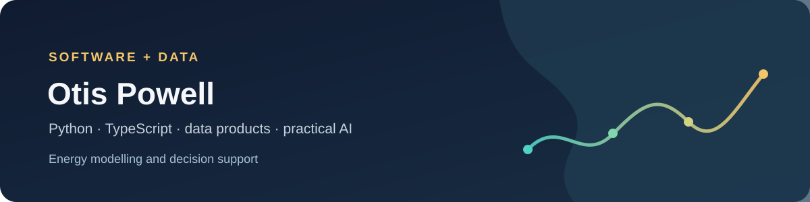

# Hi, I'm Otis Powell

I'm a **Software & Data Engineer** working on energy-system software: interactive data visualisation, AI assistants for energy modelling, PLEXOS and PyPSA data pipelines, and the websites that make that work understandable. I work across Python, SQL, TypeScript, Next.js and applied LLM tooling.

Open to engineering roles, freelance projects and collaboration.

## Live work

Most of the source code below is private, but you can explore each project in your browser.

### [Project Artemis: Visualisations](https://projectartemis.terajouleenergy.com/visualisations)
*Terajoule Energy · interactive energy-system visualisation*

An interactive explorer for an energy model of a lunar base in its 2035 reference case. You can view one hour or the whole year across electricity generation and demand (solar, nuclear, fuel-cell backup and battery), water production and reserves, electrolysis, oxygen demand and rover charging. A Lunar Atlas view sits alongside the charts. Every chart comes from the same saved model solution as the report. You can switch between hourly values, daily averages and yearly totals, and download the plotted data with its sources.

### [Nohm: Energy intelligence platform](https://nohm-website-v2.vercel.app/)
*Exajoule Ireland with Terajoule Energy · product website and platform*

Nohm helps energy analysts build a scenario, assess its economics and explain the result, with each assumption traceable to its source. I worked on:

- **The product website** (Next.js), covering Atlas, the platform, the assistant roster and the animated Readout status marks.
- **Specialist AI assistants** with their own tools and evidence trails: Emil for PLEXOS and PyPSA modelling, Theo for economics, Lola for reporting and Nova for meetings and knowledge. Consequential model changes pause for human approval.
- **Modelling pipelines**, including Open-TYNDP data preparation for PLEXOS and PyPSA, and PLEXOS XML automation.
- **Hosted pilot infrastructure**: a deny-by-default gateway, Postgres with pgvector on a private network, Terraform, a threat model and release acceptance tests.

The application itself runs as a [hosted pilot](https://nohm-pilot.terajouleenergy.com/). Sign-in is limited to Terajoule accounts, so the public website above is the part you can explore.

### [Passport Powell](https://www.passportpowell.com)
*Personal project · Next.js, React, Three.js, Supabase*

My travel website. It has an interactive 3D globe, 47 countries and 150 places, a photo archive of 239 of my own photographs, a journal and a day-by-day trip planner. Each destination listed is one I've actually been to.

### [Musu K. Powell](https://musukpowell.com/)
*Client project · author website*

A website for fantasy writer Musu K. Powell. A story-led homepage introduces her debut short story, *Wendy the Witch and the Double-Decker Bus*, with an interactive "Where's Ketty's Mark?" seek-and-find made with her illustrator, a notebook section, a newsletter signup and a contact page. Some sections are marked "coming soon" while the writing is in progress.

## More energy and data work

- **[EV vs ICE Intelligence Lab](https://github.com/passportpowell/EV-vs-ICE-Intelligence-Lab-Full-Stack-AI-Data-Product)**: a Python/SQLite pipeline and Next.js dashboard comparing vehicle running costs and emissions, using current DESNZ fuel data. The repo has CI, end-to-end tests and CodeQL. [Live demo](https://ev-vs-ice-intelligence-lab-full-sta.vercel.app)
- **[UK Population Estimate Explorer](https://github.com/passportpowell/uk-dating-pool-calculator-streamlit)**: interactive estimates from published UK demographic statistics, with a documented [methodology](https://github.com/passportpowell/uk-dating-pool-calculator-streamlit/blob/main/v3/AUDIT.md). [Live](https://dating-pool-pi.vercel.app/)

## Tools I use

- **Energy:** PLEXOS, PyPSA, TYNDP datasets, demand and scenario modelling.
- **Data:** Python, pandas, NumPy, SQL, SQLite, Postgres/pgvector, AWS S3.
- **Web and visualisation:** TypeScript, Next.js, React, Three.js, Plotly, Streamlit.
- **AI and infrastructure:** LLM agents and MCP, Docker, Terraform, Vercel, GitHub Actions.

## Get in touch

For engineering roles, projects or collaboration: **[LinkedIn](https://www.linkedin.com/in/otispowell/)**.

Based in the United Kingdom · [passportpowell.com](https://www.passportpowell.com)
